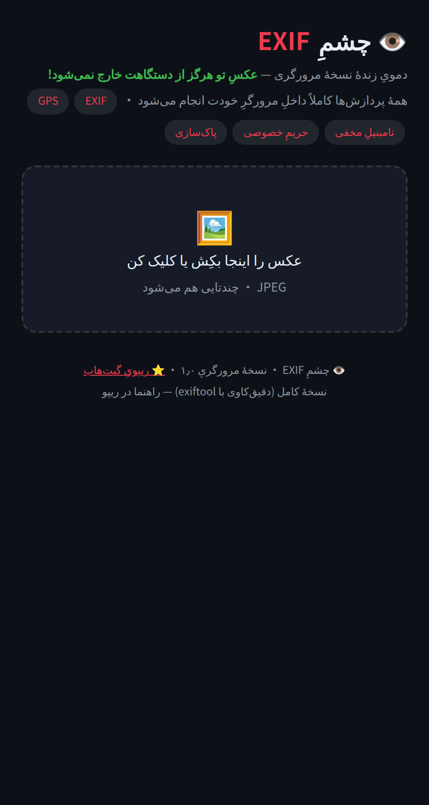
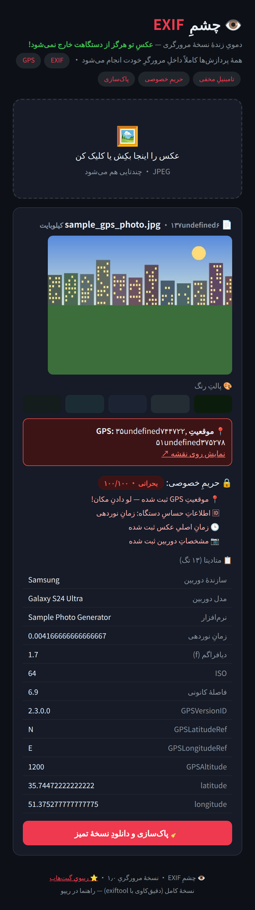
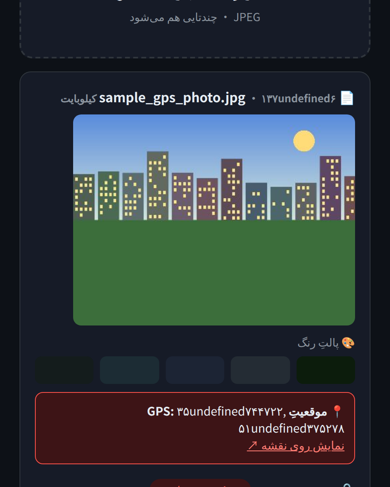

# 👁️ چشمِ EXIF — ExifEye-Web

<p align="center">
  <b>وب‌اپلیکیشنِ فارسیِ تحلیل، دقیق‌کاوی و پاک‌سازیِ متادیتایِ تصاویر</b><br>
  تماماً محلی — عکسِ شما هرگز از دستگاهتان خارج نمی‌شود.
</p>

<p align="center">
  <a href="https://laoballi.github.io/ExifEye-Web/">🌐 دموی زنده</a> ·
  <a href="#-ویژگیها">✨ ویژگی‌ها</a> ·
  <a href="#-نصب-و-اجرا">🚀 نصب</a> ·
  <a href="#-معماری-api">🏗 API</a> ·
  <a href="#-پرسشهای-پرتکرار">❓ FAQ</a>
</p>

---

## 🌐 دموی زنده

**[laoballi.github.io/ExifEye-Web](https://laoballi.github.io/ExifEye-Web/)** — نسخه‌ی مرورگریِ کاملاً سمتِ کلاینت: تحلیلِ EXIF، GPS، تامبنیلِ مخفی و پاک‌سازی، همه داخلِ مرورگرِ خودتان با JavaScript — بدونِ هیچ سرور و بدونِ آپلود.

## 📸 اسکرین‌شات‌ها

| صفحه‌ی اصلی | تحلیلِ کامل |
|---|---|
|  |  |

| GPS و حریمِ خصوصی |
|---|
|  |

> عکسِ نمونه: GPS واقعیِ برجِ میلادِ تهران + Samsung Galaxy S24 Ultra — ساخته‌شده برایِ تست.

> 🙏 الهام‌گرفته از [Amirprx3/ExifEye-Pro](https://github.com/Amirprx3/ExifEye-Pro) (MIT).

---

## ✨ ویژگی‌ها

### 📊 تحلیلِ پایه
- استخراجِ کاملِ EXIF با **ترجمه‌ی فارسیِ** تگ‌ها (سازنده‌ی دوربین، ISO، دیافراگم، نوردهی، لنز، تاریخ و…)
- **GPS** با reverse-geocoding به فارسی + لینکِ مستقیمِ Google Maps
- تحلیلِ کیفیتِ تصویر: تیزی، روشنایی، کنتراست، نمره‌ی کلِ ۰–۱۰۰ و وضعیتِ بلور
- پالتِ رنگِ غالب با سواچ‌هایِ رنگی

### 🔒 حریمِ خصوصی
- امتیازِ ریسکِ ۰–۱۰۰ با سطح‌بندیِ رنگی: **پاکیزه / کم / متوسط / بالا / بحرانی**
- هشدارهایِ هوشمندِ فارسی:
  - 📍 موقعیتِ GPS ثبت شده — لو دادنِ مکان!
  - 🆔 سریالِ دستگاه / یادداشتِ کاربر / نرم‌افزار
  - 🕒 زمانِ اصلیِ عکس ثبت شده
  - 📷 مشخصاتِ دوربین ثبت شده
  - 🕳 دیتایِ پنهانِ بعد از پایانِ تصویر (موشن‌فوتو / واترمارک / فایلِ چسبیده)
- **پاک‌سازیِ یک‌کلیکی** و دانلودِ نسخه‌ی تمیز (بدونِ هرگونه متادیتا)

### 🔬 دقیق‌کاوی (Forensics) — نسخه‌ی سرور
چهار ماژولِ کاوشِ عمیق:
1. **تامبنیلِ مخفیِ EXIF** — کپیِ کوچکی از عکس که داخلِ EXIF جاسازی شده و معمولاً **نسخه‌ی قبلِ ویرایش** (کراپ/فیلتر) است! بازسازی و نمایشِ زنده
2. **اثرِ انگشتِ جدولِ کوانتیزاسیونِ JPEG** — استخراجِ QT از بایت‌هایِ خام و تطبیق با دیتابیسِ الگوها؛ شناساییِ سازنده/نرم‌افزار (iPhone، Samsung، Pixel، Photoshop، Telegram…) **حتی با EXIFِ پاک‌شده**
3. **کاوشِ دیتایِ پنهانِ بعدِ EOI** — تشخیص و پیش‌نمایشِ هر بایتی بعد از پایانِ رسمیِ تصویر: ویدیویِ موشن‌فوتو، PNG جاسازی‌شده، واترمارک، متنِ مخفی + نمایشِ hex
4. **MakerNotes کامل با موتورِ exiftool** — صدها تگِ عمیق که exifread نمی‌بیند: سریالِ سنسور، شاتتر-کاونت، دمایِ سنسور، فریم‌ور، شناسه‌ی یکتایِ تصویر؛ تگ‌هایِ حساس با 🚨 علامت می‌خورند

### 🎨 رابطِ کاربری
- کاملاً **فارسی و RTL** با فونتِ Vazirmatn و اعدادِ فارسی (۰۱۲۳)
- تمِ تیره‌ی مدرن، درگ‌اند‌دراپ، چندفایلی، پیش‌نمایشِ عکس
- فرانت‌اندِ تک‌فایل — بدونِ نیاز به build و node

---

## 🚀 نصب و اجرا

### نسخه‌ی سرور (کامل — با دقیق‌کاوی)

```bash
# ۱) پیش‌نیازها: Python 3.10+
python -m venv venv && source venv/bin/activate   # ویندوز: venv\Scripts\activate

# ۲) وابستگی‌ها
pip install -r requirements.txt

# ۳) exiftool (برایِ MakerNotes — اختیاری ولی توصیه‌شده)
sudo apt install libimage-exiftool-perl      # اوبونتو/دبیان
brew install exiftool                        # macOS

# ۴) اجرا
python app.py
# → http://localhost:8097
```

### نسخه‌ی مرورگری (بدونِ سرور)
فقط `docs/index.html` را در مرورگر باز کنید — همین! همه‌چیز داخلِ مرورگر پردازش می‌شود.
*(یا از [دموی زنده](https://laoballi.github.io/ExifEye-Web/) استفاده کنید.)*

### Docker (اختیاری)
```bash
docker run -p 8097:8097 python:3.12-slim sh -c "
  apt update && apt install -y libimage-exiftool-perl &&
  pip install fastapi uvicorn pillow exifread python-multipart"
# سپس app.py را مونت و اجرا کنید
```

---

## 🏗 معماری (API)

```
app.py         → FastAPI + رابطِ کاربری (تک‌فایل) + endpoints
forensics.py   → موتورِ دقیق‌کاوی: تامبنیلِ مخفی، QT-fingerprint، after-EOI، exiftool bridge
docs/          → دموی مرورگری (GitHub Pages)
```

| متد | مسیر | کار |
|---|---|---|
| `GET` | `/` | رابطِ کاربری (HTML) |
| `POST` | `/analyze` | EXIF + کیفیت + GPS + ریسکِ privacy (multipart: `file`) |
| `POST` | `/strip` | پاک‌سازیِ کامل → تصویرِ تمیز |
| `POST` | `/forensics` | گزارشِ دقیق‌کاوی (۴ ماژول، JSON) |
| `GET` | `/static/*` | فایل‌هایِ ثابت |

**نمونه‌ی پاسخِ `/forensics`:**
```json
{
  "thumbnail": {"found": true, "size": 41234, "dims": "1600×1200", "b64": "…"},
  "fingerprint": {"tables": [{"id": 0, "first8": [8,8,8,9,12,14,18,24]}], "matches": ["Samsung Galaxy"]},
  "hidden_data": {"trailing_bytes": {"size": 245760, "kind": "ویدیوی MP4 جاسازی‌شده"}},
  "maker_groups": {"MakerNotes": [{"fa": "سریالِ سنسور (خیلی حساس!)", "sensitive": true}]}
}
```

---

## 🔐 حریمِ خصوصی

- **نسخه‌ی مرورگری:** عکس ۱۰۰٪ داخلِ مرورگرِ شما پردازش می‌شود — صفرِ تماسِ شبکه برایِ خودِ عکس (فقط بارگیریِ کتابخانه‌ی exifr از CDN در ابتدا)
- **نسخه‌ی سرور:** عکس فقط در حافظه‌ی سرورِ محلیِ خودتان پردازش می‌شود؛ رویِ دیسک نوشته نمی‌شود
- تنها تماسِ خارجیِ اختیاری: reverse-geocoding مختصاتِ GPS از BigDataCloud (مختصات می‌رود، خودِ عکس هرگز)

---

## ❓ پرسش‌هایِ پرتکرار

**چرا عکسم GPS نشان نمی‌دهد؟**
سه دلیلِ رایج: ۱) عکس از تلگرام/واتساپ گرفته شده (این اپ‌ها موقعِ ارسال متادیتا را حذف می‌کنند) ۲) اسکرین‌شات است ۳) location دوربینِ گوشی خاموش است. عکسِ اصلیِ دست‌نخورده را امتحان کنید.

**تفاوتِ نسخه‌ی مرورگری و سرور چیست؟**
مرورگری: EXIF، GPS، تامبنیلِ مخفی، پاک‌سازی — بدونِ نصب. سرور: + دقیق‌کاویِ کامل با exiftool (MakerNotes، اثرِ انگشتِ QT، after-EOI).

**پاک‌سازی چگونه کار می‌کند؟**
نسخه‌ی سرور: بازترسیمی از پیکسل‌ها با Pillow (صفرِ متادیتا). مرورگری: canvas re-encode با کیفیتِ ۹۵.

**آیا عکس‌هایِ HEIC/RAW پشتیبانی می‌شوند؟**
نسخه‌ی مرورگری: JPEG فعلاً. سرور: با نصبِ exiftool و افزوده‌شدنِ آن به `analyze`، به‌راحتی گسترش می‌یابد — PR خوش‌آمدید!

---

## 🗺 نقشه‌ی راه
- [ ] پشتیبانیِ HEIC و RAW در نسخه‌ی سرور
- [ ] اسکنِ دسته‌ایِ یک پوشه + گزارشِ CSV
- [ ] تشخیصِ C2PA / Content Credentials (عکس‌هایِ AI)
- [ ] حالتِ نورِ روشن
- [ ] نسخه‌ی PWA برایِ نصب رویِ موبایل

## 🤝 مشارکت
PRها آزاد است — به‌خصوصِ گسترشِ دیتابیسِ QT-fingerprint و ترجمه‌هایِ تگ‌ها.

## 📄 لایسنس
MIT — همان‌طور که پروژه‌ی الهام‌بخش. [کامل را ببینید](LICENSE)
